<div align="center">

<!-- HERO BANNER: typewriter roles + animated chef & headphone octopus mascots -->
<picture>
  <source media="(prefers-color-scheme: dark)" srcset="assets/hero/hero-dark.svg">
  <source media="(prefers-color-scheme: light)" srcset="assets/hero/hero-light.svg">
  
</picture>

<br><br>

<a href="#about"><code>ABOUT</code></a> &nbsp;•&nbsp;
<a href="#snapshot"><code>SNAPSHOT</code></a> &nbsp;•&nbsp;
<a href="#skills"><code>SKILLS</code></a> &nbsp;•&nbsp;
<a href="#projects"><code>PROJECTS</code></a> &nbsp;•&nbsp;
<a href="#ai-lab"><code>AI LAB</code></a> &nbsp;•&nbsp;
<a href="#system-design"><code>SYSTEM DESIGN</code></a> &nbsp;•&nbsp;
<a href="#voice-ai"><code>VOICE AI</code></a> &nbsp;•&nbsp;
<a href="#leetcode"><code>LEETCODE</code></a> &nbsp;•&nbsp;
<a href="#github-analytics"><code>GITHUB</code></a> &nbsp;•&nbsp;
<a href="#experience"><code>EXPERIENCE</code></a> &nbsp;•&nbsp;
<a href="#education"><code>EDUCATION</code></a> &nbsp;•&nbsp;
<a href="#contact"><code>CONTACT</code></a>

<br><br>


<br>


</div>

<a name="about" id="about"></a>
<div align="center"></div>

### 01 // EXECUTIVE INTRO

**Computer Science Engineering student who likes to understand a system before building on it.** I focus on **full-stack and backend engineering, distributed systems and applied AI**, with a preference for hard problems and practical solutions.

I have shipped a MERN asset platform used by ~500 people at Airports Authority of India, built real-time STT-to-TTS voice agents with LiveKit and WebRTC, and engineered multi-agent RAG and cloud-native AI platforms from the ground up.

```python
class Roshan:
    role      = "Software Engineer"
    education = "B.E. CSE, Chennai Institute of Technology (2024 - 2028), CGPA 8.17"
    location  = "Chennai, India"
    strengths = ["Backend & Distributed Systems", "Agentic AI & Hybrid RAG", "Real-Time Voice AI", "DSA in C++"]
    languages = ["Python", "C++", "JavaScript", "TypeScript", "Go", "Rust"]
    philosophy = "Design with clarity - Build for resilience - Measure - Ship"
```

<a name="snapshot" id="snapshot"></a>
<div align="center"></div>

### 02 // RECRUITER QUICK-SCAN

<table>
<tr>
<td width="33%" valign="top">

#### 🤖 AI Systems
- **Agentic AI:** LangGraph multi-agent supervisors, MCP tools, human-in-the-loop approvals
- **Hybrid RAG:** ChromaDB + BM25 fused with Reciprocal Rank Fusion, LLM reranking
- **Voice AI:** LiveKit, WebRTC, STT/TTS, barge-in handling
- **ML:** XGBoost, Random Forest, LSTM, PyTorch, TensorFlow

</td>
<td width="33%" valign="top">

#### ⚙️ Backend & Architecture
- **APIs:** FastAPI, Node.js, Express, REST, GraphQL, gRPC, WebSockets
- **Security:** JWT, OAuth2, RBAC, audit logging, Postgres Row-Level Security
- **Data:** PostgreSQL, MongoDB, Redis, Elasticsearch, ChromaDB
- **Systems languages:** Go and Rust microservices

</td>
<td width="33%" valign="top">

#### 🚀 Frontend, Cloud & DSA
- **Frontend:** React, Next.js, TypeScript, Zustand, Tailwind CSS
- **Cloud & DevOps:** AWS (EC2, S3, RDS), Docker, GitHub Actions, CI/CD, Prometheus, Grafana
- **Problem solving:** LeetCode Knight, 1,970+ contest rating, 475+ solved; CodeChef 200+ solved

</td>
</tr>
</table>

<div align="center">

<picture>
  <source media="(prefers-color-scheme: dark)" srcset="assets/diagrams/engineering-os-dark.svg">
  <source media="(prefers-color-scheme: light)" srcset="assets/diagrams/engineering-os-light.svg">
  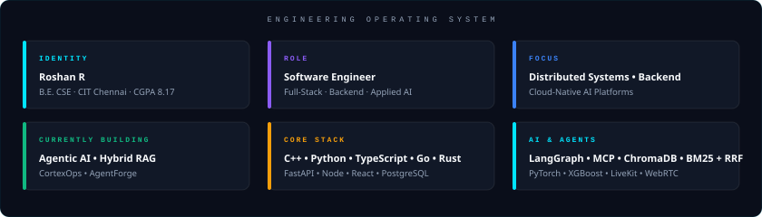
</picture>

</div>

<a name="skills" id="skills"></a>
<div align="center"></div>

### 03 // TECH STACK IN MOTION

<div align="center">

<picture>
  <source media="(prefers-color-scheme: dark)" srcset="assets/tech/skills-marquee-dark.svg">
  <source media="(prefers-color-scheme: light)" srcset="assets/tech/skills-marquee-light.svg">
  
</picture>

</div>

| | |
|---|---|
| **Core** | Data Structures & Algorithms (C++) · Competitive Programming |
| **Languages** | Python · C++ · JavaScript · TypeScript · Go · Rust |
| **Frontend & Mobile** | React.js · Next.js · Tailwind CSS · Zustand · HTML · CSS |
| **Backend & Full Stack** | MERN · Node.js · Express.js · FastAPI · REST · WebSockets · GraphQL · gRPC · JWT · OAuth2 · RBAC · Mongoose · SQLAlchemy · Alembic |
| **Databases & Search** | PostgreSQL · MongoDB · Redis · Elasticsearch · ChromaDB · Firestore |
| **AI/ML & Retrieval** | LangGraph · Multi-Agent Systems · Hybrid RAG (BM25, RRF) · MCP · NetworkX · Hugging Face · PyTorch · TensorFlow · Scikit-learn · XGBoost |
| **Real-Time & Testing** | LiveKit · WebRTC · STT/TTS · Playwright · Regression Testing |
| **Cloud & DevOps** | AWS (EC2, S3, RDS) · Docker · Git · GitHub Actions · CI/CD · Linux · Prometheus · Grafana |

<div align="center"></div>

### 04 // LIVE TERMINAL

<div align="center">

<picture>
  <source media="(prefers-color-scheme: dark)" srcset="assets/terminal/terminal-dark.svg">
  <source media="(prefers-color-scheme: light)" srcset="assets/terminal/terminal-light.svg">
  
</picture>

</div>

<div align="center"></div>

### 05 // HOW I THINK

<div align="center">

<picture>
  <source media="(prefers-color-scheme: dark)" srcset="assets/diagrams/engineering-pipeline-dark.svg">
  <source media="(prefers-color-scheme: light)" srcset="assets/diagrams/engineering-pipeline-light.svg">
  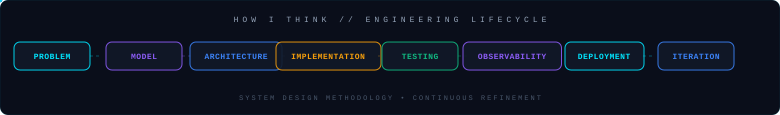
</picture>

</div>

<a name="projects" id="projects"></a>
<div align="center"></div>

### 06 // FEATURED PROJECT CASE STUDIES

<table>
<tr>
<td width="50%" valign="top">

### 🌐 RConnectX
**Multi-Sided Professional Networking Platform**

- **Problem:** Founders, students, developers and employees lacked one place for contextual discovery and real-time conversation.
- **Built:** Real-time WebSocket messaging and AI matching using the open-source `all-MiniLM-L6-v2` embedding model; containerized with Docker and deployed on AWS (EC2, RDS, S3) behind a load balancer.
- **Stack:** `Next.js` `TypeScript` `FastAPI` `PostgreSQL` `WebSockets` `OAuth2` `Docker` `AWS`
- **Links:** [Repository](https://github.com/Roshanrameshhub/nexus) &nbsp;|&nbsp; [Live Platform](https://rconnectx.com/)

<div align="center">
<picture>
  <source media="(prefers-color-scheme: dark)" srcset="assets/projects/rconnectx-arch-dark.svg">
  <source media="(prefers-color-scheme: light)" srcset="assets/projects/rconnectx-arch-light.svg">
  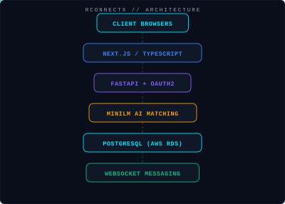
</picture>
</div>

</td>
<td width="50%" valign="top">

### 🤖 AgentForge
**Multi-Agent AI Orchestration Framework**

- **Problem:** Multi-agent systems need deterministic routing, persistent state and safe tool use.
- **Built:** A supervisor-driven, 12-stage LangGraph pipeline covering safety checks, intent routing, query rewriting, retrieval, NetworkX knowledge-graph reasoning, tool use and evaluation. Hybrid RAG (ChromaDB + BM25 + RRF + LLM reranking), human-in-the-loop approvals, MCP tools, PostgreSQL state, Prometheus/Grafana observability.
- **Stack:** `Python` `LangGraph` `FastAPI` `ChromaDB` `NetworkX` `MCP` `PostgreSQL` `Prometheus`
- **Links:** [Repository](https://github.com/Roshanrameshhub/AgentForge) &nbsp;⭐ 7 Stars &nbsp;|&nbsp; `MIT License`

<div align="center">
<picture>
  <source media="(prefers-color-scheme: dark)" srcset="assets/projects/agentforge-arch-dark.svg">
  <source media="(prefers-color-scheme: light)" srcset="assets/projects/agentforge-arch-light.svg">
  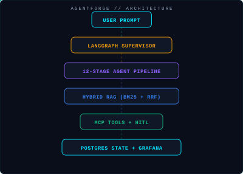
</picture>
</div>

</td>
</tr>
<tr>
<td width="50%" valign="top">

### ☁️ CortexOps
**Cloud-Native AI Model Lifecycle & Inference Platform**

- **Problem:** Publishing, discovering and serving AI models across tenants needs strict validation, lineage and metering.
- **Built:** Microservices over REST, gRPC and GraphQL with 10-phase publish validation, a model registry, Elasticsearch semantic discovery and DAG-based lineage. A Rust/Axum inference service with token-level metering and Redis rate limiting, TensorFlow recommendation models, and PostgreSQL Row-Level Security tenant isolation through a Go gRPC policy engine.
- **Stack:** `Go` `Rust` `FastAPI` `GraphQL` `gRPC` `PostgreSQL` `Elasticsearch` `Redis` `TensorFlow`
- **Links:** [Repository](https://github.com/roshanrameshhub/CortexOps)

<div align="center">
<picture>
  <source media="(prefers-color-scheme: dark)" srcset="assets/projects/cortexops-arch-dark.svg">
  <source media="(prefers-color-scheme: light)" srcset="assets/projects/cortexops-arch-light.svg">
  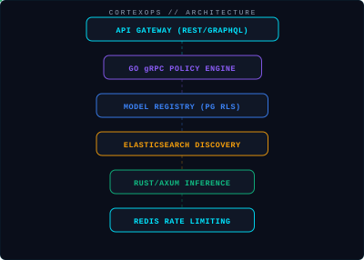
</picture>
</div>

</td>
<td width="50%" valign="top">

### ✈️ AAI Asset Management System
**MERN-Stack Platform in Daily Use at Airports Authority of India**

- **Problem:** Manual registers and spreadsheets for 5,000-7,000 assets.
- **Built:** Replaced them with a React 19 + Vite app used across 5 departments by ~500 users. Node/Express REST APIs and Mongoose models cover registration, assignment, transfer, return, retirement, custody history and service-desk tickets, with JWT auth, RBAC and audit logging, QR labels, PDF handover/audit documents and validated bulk Excel import with duplicate detection.
- **Stack:** `React 19` `Vite` `Node.js` `Express` `MongoDB` `Mongoose` `JWT`
- **Links:** [Repository](https://github.com/Roshanrameshhub/Airport-Authority-of-India)

<div align="center">
<picture>
  <source media="(prefers-color-scheme: dark)" srcset="assets/projects/aai-arch-dark.svg">
  <source media="(prefers-color-scheme: light)" srcset="assets/projects/aai-arch-light.svg">
  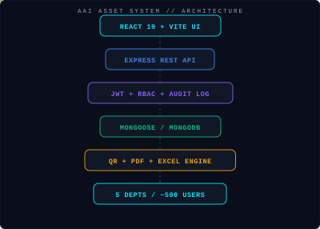
</picture>
</div>

</td>
</tr>
</table>

#### More builds

<table>
<tr>
<td width="50%" valign="top">

### 🌱 SmartFert-AI
**AI + IoT Precision Agriculture** · ESP32 soil telemetry, ML-based NPK prediction and automated valve dispensing.
`Python` `FastAPI` `React` `TypeScript` `ESP32` `Scikit-learn` · [Repository](https://github.com/Roshanrameshhub/SmartFert-ai)

<div align="center">
<picture>
  <source media="(prefers-color-scheme: dark)" srcset="assets/projects/smartfert-arch-dark.svg">
  <source media="(prefers-color-scheme: light)" srcset="assets/projects/smartfert-arch-light.svg">
  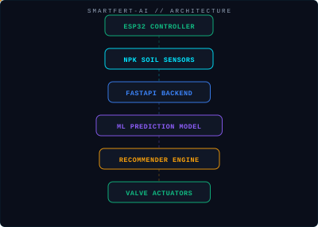
</picture>
</div>

</td>
<td width="50%" valign="top">

### 🛡️ Guardian-AI
**AI-Powered Personal Safety** · Voice distress detection, fall detection, live GPS and instant multi-channel SOS.
`Flutter` `Dart` `FastAPI` `Gemini AI` `PostgreSQL` `Redis` `Twilio` · [Repository](https://github.com/Roshanrameshhub/guardian-ai)

<div align="center">
<picture>
  <source media="(prefers-color-scheme: dark)" srcset="assets/projects/guardian-arch-dark.svg">
  <source media="(prefers-color-scheme: light)" srcset="assets/projects/guardian-arch-light.svg">
  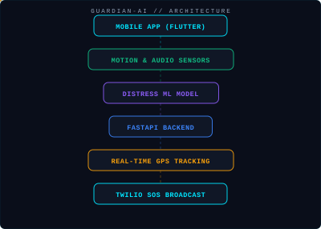
</picture>
</div>

</td>
</tr>
</table>

<a name="ai-lab" id="ai-lab"></a>
<div align="center"></div>

### 07 // AI ENGINEERING LAB

<div align="center">

<picture>
  <source media="(prefers-color-scheme: dark)" srcset="assets/architecture/ai-lab-dark.svg">
  <source media="(prefers-color-scheme: light)" srcset="assets/architecture/ai-lab-light.svg">
  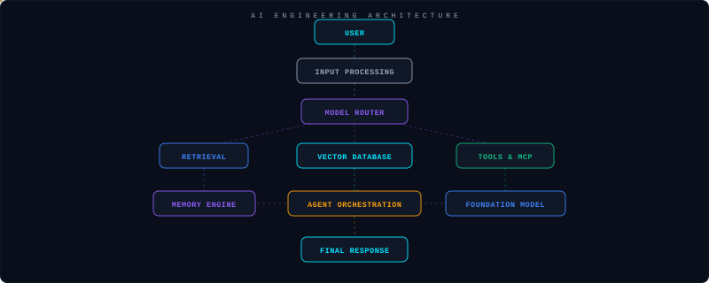
</picture>

<br><br>

<picture>
  <source media="(prefers-color-scheme: dark)" srcset="assets/architecture/rag-pipeline-dark.svg">
  <source media="(prefers-color-scheme: light)" srcset="assets/architecture/rag-pipeline-light.svg">
  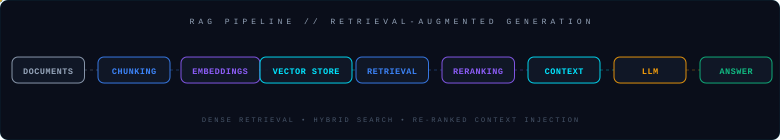
</picture>

<br><br>

<picture>
  <source media="(prefers-color-scheme: dark)" srcset="assets/architecture/agent-architecture-dark.svg">
  <source media="(prefers-color-scheme: light)" srcset="assets/architecture/agent-architecture-light.svg">
  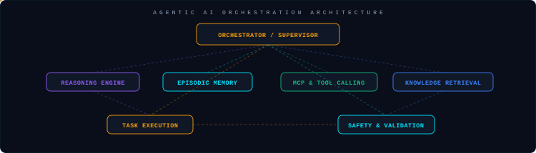
</picture>

</div>

<a name="system-design" id="system-design"></a>
<div align="center"></div>

### 08 // SYSTEM DESIGN & DEVOPS

<div align="center">

<picture>
  <source media="(prefers-color-scheme: dark)" srcset="assets/architecture/system-design-dark.svg">
  <source media="(prefers-color-scheme: light)" srcset="assets/architecture/system-design-light.svg">
  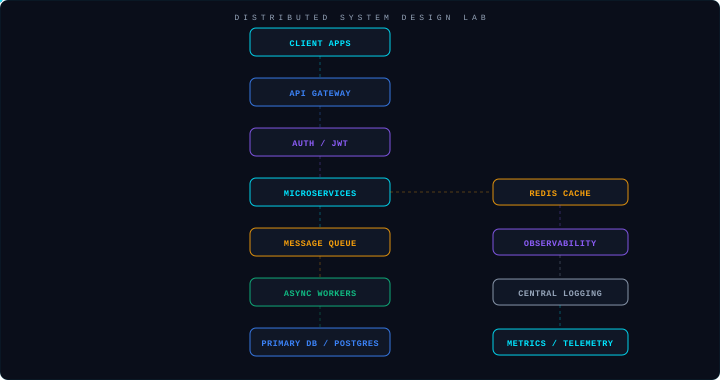
</picture>

<br><br>

<picture>
  <source media="(prefers-color-scheme: dark)" srcset="assets/architecture/devops-pipeline-dark.svg">
  <source media="(prefers-color-scheme: light)" srcset="assets/architecture/devops-pipeline-light.svg">
  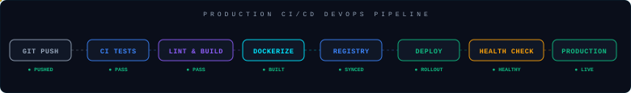
</picture>

</div>

<a name="voice-ai" id="voice-ai"></a>
<div align="center"></div>

### 09 // REAL-TIME VOICE AI & IoT

<table>
<tr>
<td width="50%" valign="top">

#### 🎙️ Voice AI Pipeline (LiveKit & WebRTC)
<picture>
  <source media="(prefers-color-scheme: dark)" srcset="assets/architecture/voice-ai-dark.svg">
  <source media="(prefers-color-scheme: light)" srcset="assets/architecture/voice-ai-light.svg">
  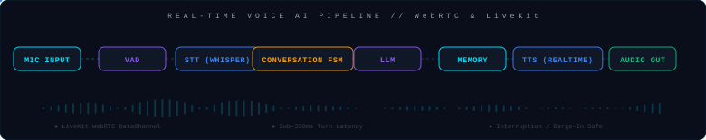
</picture>

- **Built at CATI AI:** real-time STT-to-TTS agents with multi-turn dialogue state in React + Zustand
- **Handled:** state-sync conflicts, barge-in interruptions and response-latency tuning
- **Integrations:** Shopify and WhatsApp-triggered flows, web scraping, real-time event orchestration

</td>
<td width="50%" valign="top">

#### 🌱 IoT & Hardware Telemetry
<picture>
  <source media="(prefers-color-scheme: dark)" srcset="assets/architecture/iot-system-dark.svg">
  <source media="(prefers-color-scheme: light)" srcset="assets/architecture/iot-system-light.svg">
  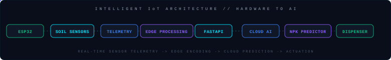
</picture>

- **Microcontroller:** ESP32 with soil sensor bus
- **Telemetry:** JSON over HTTP/WebSocket to FastAPI
- **Automation:** closed loop from ML prediction to valve actuation (SmartFert-AI)

</td>
</tr>
</table>

<div align="center"></div>

### 10 // TECHNOLOGY CONSTELLATION

<div align="center">

<picture>
  <source media="(prefers-color-scheme: dark)" srcset="assets/tech/constellation-dark.svg">
  <source media="(prefers-color-scheme: light)" srcset="assets/tech/constellation-light.svg">
  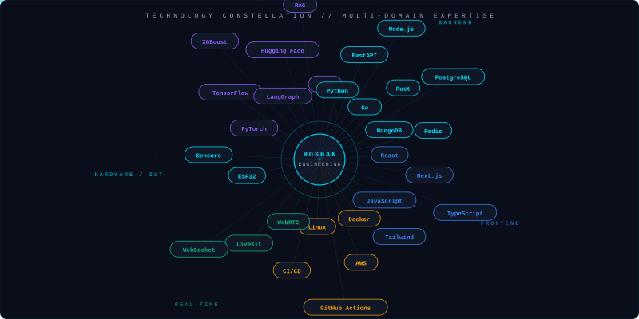
</picture>

</div>

<a name="leetcode" id="leetcode"></a>
<div align="center"></div>

### 11 // LEETCODE COMMAND CENTER

> **Live telemetry from [@RoshanR_in](https://leetcode.com/u/RoshanR_in/)**: Knight badge, contest rating above 1,970, 475+ problems solved. Auto-synced weekly via GitHub Actions.

<div align="center">

<picture>
  <source media="(prefers-color-scheme: dark)" srcset="assets/leetcode/stats-dark.svg">
  <source media="(prefers-color-scheme: light)" srcset="assets/leetcode/stats-light.svg">
  
</picture>

<br><br>

<picture>
  <source media="(prefers-color-scheme: dark)" srcset="assets/leetcode/heatmap-dark.svg">
  <source media="(prefers-color-scheme: light)" srcset="assets/leetcode/heatmap-light.svg">
  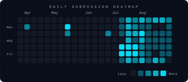
</picture>

<br><br>

<table width="100%">
<tr>
<td width="50%" align="center" valign="top">

#### 🎯 Skill Radar
<picture>
  <source media="(prefers-color-scheme: dark)" srcset="assets/leetcode/skill-radar-dark.svg">
  <source media="(prefers-color-scheme: light)" srcset="assets/leetcode/skill-radar-light.svg">
  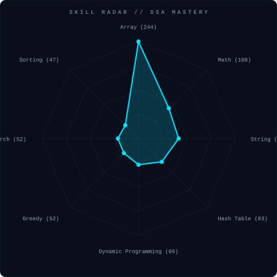
</picture>

</td>
<td width="50%" align="center" valign="top">

#### ⚡ Consistency
<picture>
  <source media="(prefers-color-scheme: dark)" srcset="assets/leetcode/streak-dark.svg">
  <source media="(prefers-color-scheme: light)" srcset="assets/leetcode/streak-light.svg">
  
</picture>

</td>
</tr>
</table>

</div>

<a name="github-analytics" id="github-analytics"></a>
<div align="center"></div>

### 12 // GITHUB ANALYTICS

<div align="center">

<picture>
  <source media="(prefers-color-scheme: dark)" srcset="assets/github/language-dna-dark.svg">
  <source media="(prefers-color-scheme: light)" srcset="assets/github/language-dna-light.svg">
  
</picture>

<br><br>

<picture>
  <source media="(prefers-color-scheme: dark)" srcset="assets/github/scoreboard-dark.svg">
  <source media="(prefers-color-scheme: light)" srcset="assets/github/scoreboard-light.svg">
  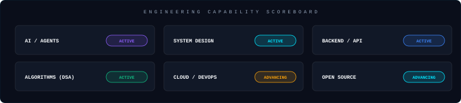
</picture>

<br><br>

<picture>
  <source media="(prefers-color-scheme: dark)" srcset="assets/github/skyline-dark.svg">
  <source media="(prefers-color-scheme: light)" srcset="assets/github/skyline-light.svg">
  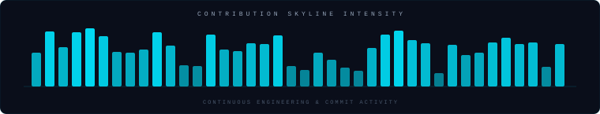
</picture>

<br><br>

<picture>
  <source media="(prefers-color-scheme: dark)" srcset="assets/github/github-contribution-grid-snake-dark.svg">
  <source media="(prefers-color-scheme: light)" srcset="assets/github/github-contribution-grid-snake-light.svg">
  
</picture>

<br><br>

<picture>
  <source media="(prefers-color-scheme: dark)" srcset="assets/github/activity-pulse-dark.svg">
  <source media="(prefers-color-scheme: light)" srcset="assets/github/activity-pulse-light.svg">
  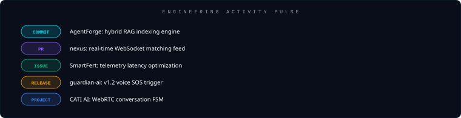
</picture>

</div>

<a name="experience" id="experience"></a>
<div align="center"></div>

### 13 // EXPERIENCE

<table>
<tr>
<td width="33%" valign="top">

#### ✈️ Airports Authority of India (AAI)
**Software Development Intern** · Sep 2026 - Oct 2026
<br>Regional HQ, Chennai International Airport

- Developed and deployed the MERN asset management system (React 19 + Vite) in daily use across 5 departments (~500 users, 5,000-7,000 assets)
- Built Node/Express REST APIs and Mongoose models for the full asset lifecycle and service-desk tickets
- Implemented JWT, RBAC and audit logging; automated QR labels, PDF handover/audit documents and bulk Excel import with duplicate detection

</td>
<td width="33%" valign="top">

#### 🎙️ CATI AI
**Autonomous Voice AI Intern** · Aug 2026 - Oct 2026
<br>Gurugram, India (Remote)

- Engineered real-time STT-to-TTS voice agents with LiveKit, WebRTC, React and Zustand; managed dialogue state, barge-in and latency
- Built backend features, an embedded floating chatbot, and Shopify / WhatsApp integrations with real-time event orchestration
- Contributed to Playwright regression testing and an independent QA test platform (dashboard, backend, runner)

</td>
<td width="33%" valign="top">

#### 🌊 Rakshan Earth and Space Technologies
**Machine Learning Intern** · Jul 2026 - Aug 2026
<br>Chennai, India

- Applied XGBoost regression, Random Forest and LSTM models to deep-sea environmental data for predictive analytics
- Built Python preprocessing and feature-engineering pipelines (imputation, noise filtering, outlier and anomaly detection)
- Analyzed how deep-sea conditions relate to species movement and habitat suitability

</td>
</tr>
</table>

<a name="education" id="education"></a>
<div align="center"></div>

### 14 // EDUCATION & CERTIFICATIONS

**🎓 Chennai Institute of Technology**: B.E. Computer Science and Engineering · **CGPA 8.17** · Sep 2024 - May 2028

<div align="center">


</div>

<a name="open-source" id="open-source"></a>
<div align="center"></div>

### 15 // OPEN SOURCE & ACHIEVEMENTS

<table>
<tr>
<td width="33%" align="center">

🏆 **LeetCode Knight**  
`Contest rating 1,970+ · 475+ solved`  
Top 3% of contest participants

</td>
<td width="33%" align="center">

🧮 **CodeChef**  
`200+ problems solved`  
Competitive programming in C++

</td>
<td width="33%" align="center">

💻 **GSSoC Contributor**  
`3 merged pull requests`  
[GirlScript Summer of Code](https://gssoc.girlscript.org/)

</td>
</tr>
<tr>
<td width="33%" align="center">

⭐ **AgentForge**  
`7 stars · MIT License`  
12-stage multi-agent framework

</td>
<td width="33%" align="center">

🌐 **RConnectX**  
`Live in production`  
[rconnectx.com](https://rconnectx.com/)

</td>
<td width="33%" align="center">

✈️ **AAI Asset System**  
`~500 daily users`  
Replaced manual registers

</td>
</tr>
</table>

<div align="center"></div>

### 16 // NOW BUILDING

```
● [ACTIVE]    Cloud-native AI platforms (CortexOps: Go + Rust + gRPC)
● [ACTIVE]    Agentic AI orchestration and hybrid RAG (LangGraph + MCP)
● [ACTIVE]    Real-time voice AI (LiveKit + WebRTC)
● [ADVANCING] Distributed system design and microservice architecture
● [ADVANCING] DSA and competitive programming (LeetCode + CodeChef)
```

```
┌────────────────────────────────────────────────────────┐
│   01. DESIGN BEFORE SCALE      02. BUILD BEFORE BOAST  │
│   03. MEASURE BEFORE OPTIMIZE  04. SHIP BEFORE PERFECT │
└────────────────────────────────────────────────────────┘
```

<a name="contact" id="contact"></a>
<div align="center"></div>

### 17 // CONNECT

<div align="center">

<a href="https://github.com/Roshanrameshhub"></a>
<a href="https://www.linkedin.com/in/roshan1833"></a>
<a href="https://leetcode.com/u/RoshanR_in/"></a>
<a href="mailto:roshanrithisha123@gmail.com"></a>

<br><br>

<a href="https://www.rconnectx.com/"></a>
<a href="https://gssoc.girlscript.org/"></a>

<br><br>

<picture>
  <source media="(prefers-color-scheme: dark)" srcset="assets/footer/footer-dark.svg">
  <source media="(prefers-color-scheme: light)" srcset="assets/footer/footer-light.svg">
  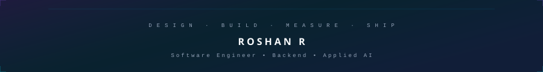
</picture>

</div>
